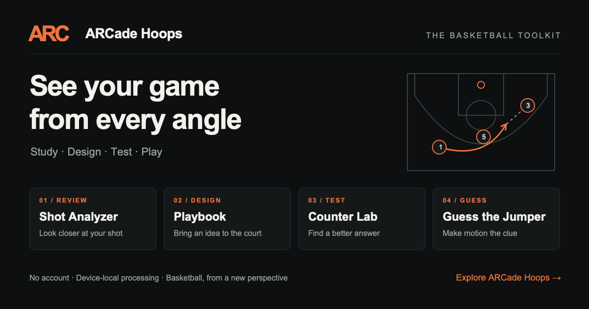

# [ARCade Hoops](https://stiwarilbj.github.io/Arc-Shot-Evaluator/#home)

> 🌐 **Live Website:** [Open ARCade Hoops →](https://stiwarilbj.github.io/Arc-Shot-Evaluator/#home)

[](https://stiwarilbj.github.io/Arc-Shot-Evaluator/#home)

ARCade Hoops is a free basketball toolkit for reviewing shooting footage, designing plays, testing defenses, playing quick basketball games, and making private silhouette clips and quizzes · Use it in the browser or run the downloaded app for full local shot analysis and video processing

## Find your tool

| **Workspace**                                                                        | **What you can do**                                                                                           |
| ------------------------------------------------------------------------------------ | ------------------------------------------------------------------------------------------------------------- |
| [Shot Analyzer](https://stiwarilbj.github.io/Arc-Shot-Evaluator/#shot-analyzer)      | Upload footage, review attempt windows and available measurements, correct results, and export shot data      |
| [Playbook](https://stiwarilbj.github.io/Arc-Shot-Evaluator/#playbook)                | Draw and simulate plays, choreograph timing, rehearse roles, teach reads, check spacing, connect bait to payoff, build walkthroughs, and exchange player responsibilities across endings |
| [Counter Lab](https://stiwarilbj.github.io/Arc-Shot-Evaluator/#counter-lab)          | Test defenses, follow recorded openings through a possession, compare repairs, and replay a defender’s dilemma |
| [Others → Guess the Jumper](https://stiwarilbj.github.io/Arc-Shot-Evaluator/#jumper) | Mask and edit your own jumpshot videos, keep a private clip library, and guess the shooter from their motion  |

**[Games → Box-Score Error Hunt](https://stiwarilbj.github.io/Arc-Shot-Evaluator/#games/box-score-error-hunt)** · Find the wrong total in fictional stat lines, build a streak, and unlock shooting percentages in endless practice

**[Games → Swish Tuner](https://stiwarilbj.github.io/Arc-Shot-Evaluator/#games/swish-tuner)** · Tune angle, power, and backspin with a bundled neural flight estimate, then make three shots to advance

## More details

- [Feature and setup guide](docs/feature-guide.md)
- [Playbook and Counter Lab replay exports](docs/simulation-export.md)
- [Accuracy and evidence protocol](docs/accuracy.md)
- [ARCade Hoops architecture](docs/architecture.md)
- [Guess the Jumper editor guide](docs/jumper-editor.md)

## Run locally

Install Node.js 22.18+, `uv`, Git, and zsh · From the project folder, run:

```sh
./scripts/setup.sh
./scripts/start.sh
```

Open <http://127.0.0.1:7888> · See the [full setup guide](docs/feature-guide.md#run-the-downloaded-app) for details
