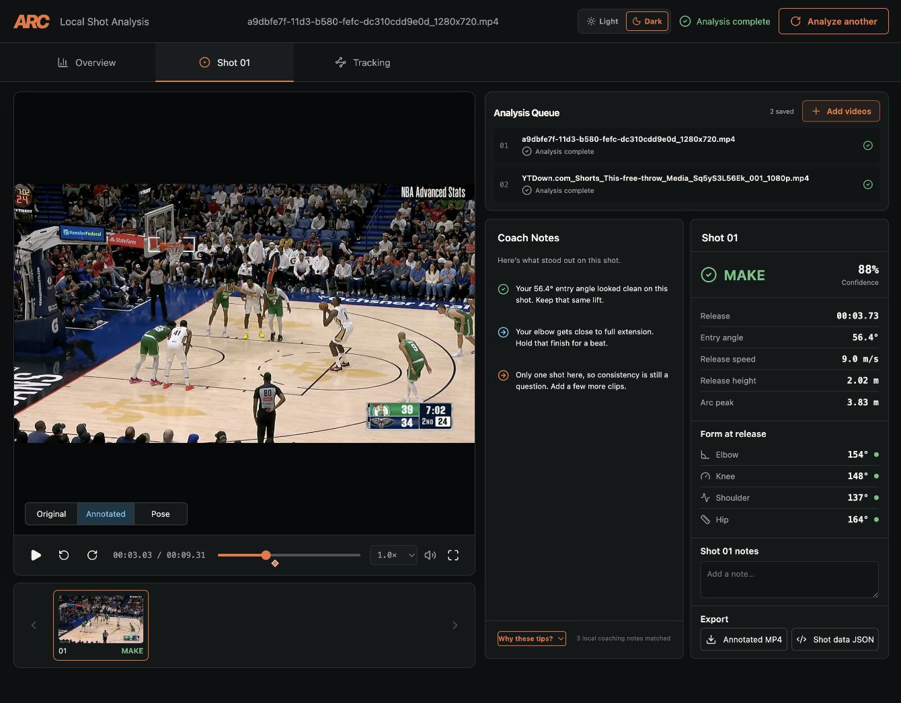

# ARCade Hoops · Feature and Setup Guide

[Back to the quick README](../README.md)

This guide contains detailed workspace behavior, local setup, development checks, and technical references

## Shot Analyzer

### Upload and review

- Select one or several videos, drag them onto the upload area, or use a supplied
  example · The current upload workflow is **Free throw**
- Choose **Fast**, **Normal** (default), or **Deep** analysis · The queue shows
  waiting, running, completed, failed, and stopped jobs; add videos, cancel work,
  hide completed items, or reopen a result · The app starts one analysis at a time
  by default
- Use **Overview**, **Shot**, and **Tracking** to inspect the session, individual
  attempts, and available movement evidence · Shot thumbnails jump to the relevant
  attempt; video controls offer **Pose**, **Annotated**, and **Original** views
  when the corresponding data is available
- Review makes, misses, and uncertain attempts · Correct outcomes and release
  timing, add a missed attempt, and keep per-shot notes · Local corrections retain
  the original model evidence rather than replacing it
- Download shot data and available video artifacts · The full local pipeline
  creates annotated video exports; the hosted motion pass uses the source video
  and available overlays rather than generating a new annotated recording

### Hosted review versus full local analysis

The GitHub Pages version samples video motion to propose windows for **manual
review** · Supplied examples can include prepared pose tracks and joint-angle
overlays · Ordinary uploaded videos do not receive full pose, ball, or rim tracking
in this hosted analysis path, and their outcomes start as **review**

The downloaded app runs the Python vision pipeline: basketball/rim detection,
player pose, temporal tracking, shot measurements, and local Coach Notes · Source
orientation and playback formats are normalized where supported · Projected
measurements are reported only when the footage and calibration support them;
weak evidence stays estimated, unavailable, or marked for review · Clear footage
with the shooter and basket visible gives the pipeline more useful evidence

Observed make rates describe reviewed footage · Future shooting probabilities
remain unavailable until a prediction model passes held-out validation and
calibration; they are not inferred from the observed percentage · See the
[accuracy and evidence protocol](accuracy.md) for the underlying analysis
fields and review rules · Some backend analysis capabilities are broader than the
current upload controls

### Local Coach Notes

The local pipeline retrieves relevant passages from a bundled shooting guide
using a BM25-style search, then selects concise notes about a strength, a practice
cue, and consistency · The guide draws on paraphrased coaching and biomechanics
sources · **Why these tips?** connects the note to its measurement and source ·
There is no online chatbot or paid language-model call

<p align="center">
  
</p>

## Playbook

### Draw and edit

Start with **Ready setup**, **Empty court**, a saved play, or one of **24 editable
starter plays** · Search sets including Horns, Flex, Spain pick-and-roll, Elevator,
Shuffle, Triangle, Zipper, Box, and High-low

Draw passes, movement, screens, slip screens, dribble handoffs, pick-and-rolls,
pick-and-pops, pin-downs, off-ball screens, and backdoor cuts · Move players,
defenders, and the ball; shape curved routes; choose action order and duration;
and give simultaneous actions the same sequence number · The action list keeps
moves accessible even when their arrows are hidden · Undo/redo, touch dragging,
and keyboard nudging support revisions

Customize offensive shooting/finishing ratings and badges, defender skills, and
simulation settings · Player strengths, defensive strategies, cuts, spacing, and
enabled automatic actions affect the simulator's decisions

### Pocket actions

Open **Pocket actions** beside the starter-play controls to reuse a small
combination inside the current play · The **Starter** shelf includes Handoff into
rescreen, Corner cut plus replacement, Give and go, and Staggered screen · Copy a
starter to **My pockets** before renaming or editing its labels

Choose **Select combination**, then tap or Shift-click routes on the court or use
the action-list checkboxes · Review selected moves and recorded participants before
saving, and provide a name plus editable role labels · If the selection omits a
simultaneous move, pinned action, or wait source, include the missing connection or
confirm that the saved copy should remove it

Drag a pocket onto the court or choose **Place on court** to assign every role to a different offensive player ·
Select a move boundary or the end of the play, then adjust the anchor, rotation, or
mirror option while checking the dashed court preview · Setup routes and a required
possession pass are shown before insertion; confirm the pass when requested ·
**Insert combination** adds ordinary editable actions as one undoable change and
opens Timing when needed · Inserting at a branch fork can update only that ending
or the shared opening, which also affects its inheriting endings

Personal pockets are private to the device · The hosted site stores them in browser
IndexedDB; the downloaded app stores them through its local API · Search, rename,
duplicate, delete, or export pocket JSON, and import a pocket file to make a new
independent copy · Later pocket edits never change actions already inserted into a
play

### Simulate and save

Play, pause, seek, or pause to edit before continuing · The shared fixed-step engine
coordinates movement and collision avoidance, executes screens in phases, follows
actual possession, requires catches for passes and close contact for handoffs,
and explains obstructed or conflicting actions · Defenders anticipate the recorded
pass receiver without awarding possession, react to loose balls rather than roster
order, and recover from screens using the actual screen-release timing · These
shared behaviors apply in both Playbook and Counter Lab; they remain basketball
simulation approximations · Adaptive offense can continue with an available cut,
roll, post action, drive, or pass; simulation decisions do not rewrite the saved
drawing · Both hosted and downloaded builds compile an internal action-dependency
graph: catches gate the receiver's next on-ball action, screen use gates rolls,
and a delayed action holds its dependents while unrelated movement retains its
planned start · Conflicting ownership and circular dependencies are diagnosed before
execution; failed prerequisites explain why dependent moves cannot start · Saved
plays keep the version-1 document format · See [action dependencies](playbook-action-dependencies.md)

### Choreograph timing

Expand **Timing** below the court to see a lane for each offensive player · Each
action appears in its primary player's lane, with linked views for its receiver,
screener, or other participant · Select a block to select its court route and action
list entry · The ruler uses seconds, while block moves snap to 0.1 seconds · Drag a
block, edit its start time, or focus it and use the arrow keys; **Shift + Arrow**
changes its minimum duration · Press **Escape** during a drag to cancel it

The orange portion marks the action's 0.5–4 second minimum duration · A hatched
tail is estimated travel time, so making the minimum shorter does not force a player
to reach a distant destination unnaturally quickly · Focus or hover a block to preview
its authored route and start/end markers without running a simulation

Use **Start together** to pin compatible actions into one group · Every member waits
until its own possession and timing requirements are satisfied, then the group starts
as one unit · **Wait until** can connect an action to another move's start, completion,
confirmed catch, screen set, screen use, or a player's actual progress to a point you
pick on that move's court route · A start can never happen before its planned time,
and all listed events must occur · If an event fails or becomes impossible, the move
is marked obstructed rather than released by a fallback timer

The first timing edit captures the current action starts as one undoable document
change · Plays that are never edited in Timing keep their existing schedule and
simulation behavior · Later actions added to a timed play begin after the current
planned finish · Timing changes follow the same Main/shared-opening and private-ending
rules as other branch edits; Counter Lab receives the selected path with its schedule
intact · Removing an action that another move waits on, changing that source action,
or joining a pinned group with conflicting movement or transfers is blocked until the
affected connection is removed or retargeted

Congested routes use short passage and destination reservations · Players can
briefly yield or take a small detour while a teammate passes, then continue to
their original destination · Circular waits get deterministic right-of-way;
unresolved traffic uses the existing bounded obstruction result · Curves, body
clearance, speed limits, and the three-foot route allowance remain in force ·
Both workspaces and build targets share this planner · See
[movement congestion](playbook-congestion.md) for its limits and regression evidence

Paused marker, rating, and badge edits are applied as one validated simulation
transaction in both builds · Compatible undo/redo retains the paused clock;
unrelated actions keep their progress, moved screens refresh their approach and
coverage, and released passes/shots keep their recorded evidence · Invalid edits
are rejected before changing the drawing · If asynchronous execution fails, the
worker pauses with the current draft and last acknowledged frame intact; **Play**
restarts from the drawing · Changing actions or the roster still
restarts playback · See [paused editing](playbook-paused-editing.md)

Playbook's **Replay** scrubber seeks within the portion already played and pauses
at the selected time · Arrow keys seek 1/30 second,
Page Up/Down seek one second, and Home/End select the recorded beginning/end ·
Resuming follows that session's original automatic defense, settings changes,
and paused edits at their recorded times · Editing or changing settings after
seeking starts a new future; seeking alone preserves the recorded future and
does not change the saved drawing or undo history · Executable checkpoints retain
possession, pending catches, movement, action phases and defensive duties, with
at most 24 checkpoints and a 16 MiB accounting budget per session · Sessions stay
in memory and are cleared by reloading or starting another play · Exact recovery
is supported within the same engine version and runtime; saved version-1 plays
remain unchanged · See [simulation sessions](playbook-simulation-sessions.md)

### Branch one opening into endings

Use **Create a branch here** on a Main action to fork before that move and copy
the selected move and every later move into a new ending · Actions sharing a move
number fork together · Main stays as the original, and up to eight labeled
endings can be edited separately · Editing an inherited shared-opening action
updates Main and every ending that still inherits it; continuation edits stay in
the selected ending · Rename, delete, create, and drawing edits support undo/redo,
while switching tabs keeps the draft clean · Endings can be empty while being
edited · If a fork action is deleted from Main, the ending keeps its copied route
and moves its shared boundary to the next surviving Main group · An inline notice
explains that adjustment

Play and PNG export use the selected complete path from the original starting
positions · **Compare with Main** overlays changed and removed Main routes and
respects the shared arrow-visibility setting · The action list marks additions and
changes and identifies shared moves · **Test in Counter Lab** sends a standalone
copy of the selected path · Saved branched plays can be imported there as Main or
one named ending at a time, and verified repairs save as standalone plays · Branch
records are an optional version-1 extension, so existing unbranched files need no
migration · The downloaded app requires a branch-aware local server before it will
save endings; browser storage upgrades atomically and older clients reject the new
storage envelope rather than discarding branches

Playbook execution runs in a dedicated browser worker, loaded on the first
**Play**, on both the hosted and downloaded builds · Drawing, input, and layout
remain on the page · Session/revision checks reject stale frames after paused
edits, settings changes, seeking, or loading another play · The transport allows
one outstanding request and caps pending advancement at 100 ms (50 ms per engine
call), so a slow device does not accumulate a long playback backlog · Hidden
browser tabs and other workspaces pause playback; resuming is explicit · A worker
error or ten-second response timeout preserves the draft, undo history, and last
valid court frame; **Play** creates a fresh session · No server or paid service is
used · See [Playbook worker execution](playbook-worker.md)

Ball control uses one shared state machine · Released passes have no controller;
handoffs remain with their giver until the exchange is confirmed · Transfers record
release, arrival, and catch/failure evidence · Failed passes leave a recoverable
loose ball, while released shots no longer count as player possession · Counter Lab
uses the same evidence and keeps ordinary pass transit separate from a lost opening ·
These behaviors apply in both builds · See [ball state](playbook-ball-state.md)

Shot quality is evaluated at the actual release, with a recorded snapshot of
shooter speed, confirmed catch timing, defender approach direction/speed,
spacing, ratings, badges, and each scoring modifier · A fast closeout and a
retreating defender at the same distance can produce different scores, as can a
settled catch and a hard cut · Once released, the evaluation stays fixed through
later position or attribute edits, playback, and seeking; a valid score of zero
stays zero · Both Playbook and Counter Lab use these rules on both build targets ·
These are simulation scores, not real shooting probabilities · See
[shot release evaluation](playbook-shot-evaluation.md) for rules and tests

Defense allocates primary, screen, help, rim-support, and recovery responsibilities
as a team · When a defender helps, an explicit rotation assigns the vacated player
or zone to a teammate and records the remaining exposure · Recovery follows that
inherited duty, screen reservations persist through the interaction, and zone
closeouts have distinct owners · Selected strategies and badges still determine
coverage; partial rosters cannot manufacture extra defenders · Both workspaces and
build targets share this behavior · See [defensive responsibilities](playbook-defense.md)

Both workspaces validate simulation settings before execution: strategies and
schemes must be supported, automatic-action switches must be booleans, and
intensity must be finite · Invalid updates leave the active run intact · Omitted
optional settings keep their existing defaults; valid movement behavior is
unchanged · See [simulation settings](simulation-settings.md) for the contract
and regression command · Both builds also reject nonfinite advancement times before
changing the accumulator, settings, or last valid frame; normal playback can resume
after rejection · Zero/negative times remain no-ops and positive times retain the
existing per-call cap

Save plays, reopen or duplicate them, delete saved copies, or export a
high-resolution PNG · Hosted plays stay in browser storage; downloaded-app plays
live in `playbooks/` · Saves protect newer edits, and opening a different play uses
the existing unsaved-draft protection · Saved plays sort newest first by actual
update time across UTC and timezone-offset formats, then by ID for ties;
missing or invalid legacy dates appear last · Updates also check the revision originally
loaded: if another tab or local client saved first, your update is rejected and
your draft stays in memory · Save a copy to keep that drawing, or reopen the latest
saved play before editing it · Legacy version-1 plays gain a revision on their next
save without changing their drawing format ·
Saved files with IDs that disagree with their filenames are excluded from the
local library and rejected on direct access · Browser libraries with duplicate
play IDs are rejected · Inconsistent records remain untouched for recovery ·
If the downloaded app cannot read every saved play, it reports an incomplete
refresh and keeps the previously loaded library · The message distinguishes
invalid documents from temporarily unavailable storage; retry after resolving
the problem · A first incomplete load reports the problem instead of presenting
the healthy subset as the entire library ·
The downloaded app validates deletion acknowledgements; if a response is
malformed or interrupted, it checks whether the play is gone before reporting
success · An unconfirmed outcome asks you to refresh before retrying ·
Local requests wait at most two seconds to acquire a saved play's lock · A busy
lock returns a retryable storage error before mutation; an expired waiter cannot
apply an update later · Writes that already acquired the lock finish normally ·
Local saves flush and synchronize temporary JSON before atomic replacement,
then synchronize the containing directory where supported · Deletions synchronize
directory changes too · If storage fails after a change was attempted, the app
reports that the save or deletion may have completed and asks you to refresh
before retrying · Creation retries recheck synchronization without duplicating
the play · These safeguards improve shutdown recovery; durability still depends
on the operating system, filesystem, and hardware · The exported drawing format
remains version 1 ·
Saved plays now retain eight recent, checksummed revisions with parent links and
explicit deletion records · Browser saves commit the drawing, history, and receipts
in one atomic transaction; the first change also retains the validated legacy
library snapshot · Locally, immutable revision files precede an atomic current-head
commit · Corrupt history blocks ordinary loading rather than silently rolling back ·
Explicit recovery makes a separate copy and preserves damaged records; it never
revives a deleted identity · Recovery is a maintenance API, without changes to the
editor controls · See [saved-play recovery](playbook-recovery.md) for access,
retention, migration, and storage limits ·
Playbook JSON intake rejects documents above 256 KiB before parsing; whole
browser library reads have a separate 16 MiB budget · Both targets reject nesting
deeper than 32 levels and retain the current draft on failed loads · The local
API counts actual uploaded bytes rather than trusting request headers · Oversized
or malformed saved files remain on disk and produce an incomplete-library warning ·
These budgets leave ample room for five players per side and all 30 actions;
see the [document validation guide](playbook-document-validation.md)

### Shared arrow visibility

Playbook and Counter Lab share one browser-persisted **Arrows** preference:

| Setting                 | Visible routes                                                           |
| ----------------------- | ------------------------------------------------------------------------ |
| Off                     | No saved or simulated route overlays                                    |
| Main on-ball (default)  | Passes, drives, handoffs, and connected screens, slips, rolls, and pops |
| Main on-ball + off-ball | Main actions, including cuts and off-ball screens                       |
| All on-ball movements   | Main on-ball actions plus smaller related adjustments                   |
| All movements           | Main actions and smaller on-ball/off-ball movement trails               |

The preference updates previews and playback immediately and is reflected in PNG
exports · It does not change simulations, saved actions, or undo history · The
actively edited action remains visible temporarily with its editing handles

## Counter Lab

Follow **Choose play → Test defenses → Inspect breakdown → Try repair**

1. Load the current Playbook draft, a saved play, or a starter. **Test in Counter
   Lab** in Playbook transfers the current drawing without discarding its editor
   state · The Lab sidebar keeps the chooser, arrow visibility, and test settings
   accessible
2. Test containment, help, switching, drop, hedge, and trapping by default. Advanced
   settings expose additional strategies and eligible zones · Compare **Drawn
   play**, which follows authored actions without voluntary improvisation, with
   **Adaptive offense**, which can respond to the defense
3. Select a defense/mode to inspect court playback, the timeline, involved players,
   and the first breakdown · Sustained opening loss requires 300 ms of evidence;
   unsafe-pass warnings are separate from confirmed execution failures · Plays
   without a clear opening or breakdown are reported that way
4. Inspect up to three verified repairs for the selected matchup. Candidates can
   change screen/slip behavior, roll/pop choices, timing, spacing, or a pass
   recipient · A repair must gain at least five quality points or resolve a genuine
   breakdown without reducing final quality or introducing an earlier failure ·
   Simply delaying failure does not qualify; sometimes no repair qualifies
5. Compare original and repaired actions with synchronized playback. Desktop uses
   side-by-side courts; narrow screens share a clock with an Original/Repair
   toggle · Tradeoff summaries show regressions against other tested defenses
6. **Save repair to Playbook** creates a separate editable copy with a fresh ID,
   preserving the original · The editor still protects an unsaved draft

Analysis runs in a browser worker on both targets, with progress and cancellation ·
Baseline results appear before repair testing finishes · Replay pauses when the
workspace or browser tab becomes hidden · Playbook edits do not erase an existing
Lab report; explicitly importing another play or reloading does · Reports remain
in memory, while saved repairs use ordinary Playbook persistence

Quality is a **simulation score**, not a real-game scoring probability · See the
[recorded movement audit](movement-audit.json) and
[save-and-simulate compatibility harness](save-simulate-compatibility.md) for
engine and persistence verification

## Guess the Jumper

Open **Others → Guess the Jumper** for **Guess**, **Create**, and **My Clips** ·
Personal videos stay on your device; they are never automatically published

### Create a silhouette clip

1. **Upload:** choose a decodable video up to **100 MB** and trim a segment to
   **15 seconds or less**
2. **Select shooter:** click or tap to aim at the target in the segment's first
   frame, adjust with the nudge buttons, then press **Place point** · Aiming never
   adds a correction; placement commits exactly one point and one undo step ·
   Arrow keys aim and Enter/Space place; re-aim before adding another point ·
   Changing the frame, track, or Include/Exclude mode discards any unplaced aim ·
   A magnifier and keyboard/touch controls help with small players · A short silhouette preview
   confirms the selected person before full processing; it can load the models ·
   The preview and full run reuse the same starting-frame shooter selection,
   including the detected body box when automatic discovery is enabled · The
   preview only tracks the shooter; full processing also discovers other people ·
   When a person box and Include point are available, nearby first-frame prompts
   must produce consistent silhouettes before full tracking starts · If they disagree,
   add another Include point on a different visible part of the same shooter and retry ·
   The check keeps your original mask; it never chooses the largest alternative ·
   If the points overlap several detected players, add an Include point on a
   visible part of the shooter away from the overlap in the first frame · If no
   player matches, clear the first-frame points and select again · Automatic
   processing waits for a unique match; it never silently falls back to a
   point-only mask · If detection keeps missing the player, turn off automatic
   discovery under corrections and verify your manual selection in the preview ·
   Other people are discovered automatically, including later entrants · During
   tracking, detections are matched against occupied mask pixels rather than
   rectangular mask outlines · Weak or competing overlap is flagged for review;
   uncertain detections are not automatically added as duplicate people ·
   Missing tracks retain a short presence record and their existing tracking
   identity · Returning players reuse that identity only when current mask evidence
   supports it · If an unmatched person appears while an existing track is missing,
   automatic discovery requests correction rather than guessing an identity or
   consuming another track slot · Longer absences remain unresolved until tracking
   evidence or a correction identifies the player
3. **Process:** track people and render a muted video up to **720p/30 fps**. The
   shooter becomes solid black, other included players gray, and the background
   flat neutral gray · Finished silhouette outputs copy no original image pixels,
   removing original court colors, jersey text, graphics, and audio · For new personal
   clips, both processors choose fixed per-player gray shades after scanning the
   full tracked segment · Players whose visible silhouettes frequently touch or
   cross get priority for stronger gray contrast · This uses tracked boundaries,
   never teams, clothing, or source colors; the shooter stays black throughout ·
   Very crowded groups have limited gray contrast, and fully hidden players do
   not supply contact evidence · Existing saved clips keep their current shades ·
   Browser rendering keeps compressed owner maps temporarily: small jobs stay in
   memory and larger ones use private scratch browser storage, removed when the
   job finishes or fails · Day-old scratch jobs left by a closed tab are cleaned on
   the next large job · If both storage and the bounded memory fallback are full,
   shorten the segment or allow browser storage; processing does not use a server
4. **Review and correct:** original reference and masked playback share one clock.
   Desktop shows them together; mobile offers a comparison toggle · The review
   timeline checks every included player, black or gray, for missing masks,
   sudden jumps, persistent outline shrinkage, abrupt local outline changes, and
   newly detached mask fragments · Adjacent silhouettes are translation-aligned
   with pixel-jitter tolerance; nearby outline loss/gain from ordinary motion is
   discounted · Shape comparisons reset at camera cuts, corrections, and gaps ·
   These checks flag suspicious small hand/arm losses; they never identify
   anatomy or generate missing limbs · Warnings identify the affected
   track and block saving until corrected · Recorded outward movement and clipping
   at the image boundary can establish a legitimate exit; an unexplained interior
   disappearance or a stationary player vanishing at the edge still needs review ·
   These are temporal mask checks, not anatomical guarantees: inspect limbs and
   overlaps in the full video, including frames without warnings · The timeline
   also flags uncertain matches and possible camera cuts · Cut detection compares
   brightness-normalized scene structure over translated image overlaps, then
   checks up to two following frames · Brief clipped flashes that return to the prior
   scene are discarded; exposure changes and supported pans retain continuity ·
   Confirmed scene changes still require trimming or correction · Transitions
   truncated at the clip end, prolonged blank flashes, very large pans, and other
   inconclusive footage may still need review; this is not a perfect cut detector ·
   To reduce black/gray boundary flicker, both processors can retain a previous
   pixel owner for at most two frames when current scores are close, both masks
   still cover that pixel, and nearby current pixels clearly support that owner ·
   Stronger occlusion evidence wins immediately; missing masks, camera cuts, new
   tracks, and correction frames bypass this consistency check · It favors no
   player or color, does not add body pixels, and cannot guarantee correct depth
   ordering during every overlap · Exact positive-score ties use the lower stable
   track ID in both processors, independent of track-list order; this tie rule
   gives no priority to the black shooter and leaves unequal-score handling intact ·
   Expand corrections to remove spectators, manage tracks, or add Include/Exclude
   points on problem frames · **Find people in first frame** preserves the chosen
   shooter, track IDs, removed tracks, and every correction · It adds distinct
   detections only after matching existing first-frame selections one-to-one;
   ambiguous or unmatched tracks leave the selections unchanged with guidance ·
   Overlapping new detections require manual selection · Undo/redo supports up
   to 50 correction edits ·
   **Add tracking anchor** opens a later original frame with the shooter and
   Include selected · Aim and **Place point** on that same person, then choose
   **Confirm shooter at frame …** · Confirmed frames appear in a seekable list;
   removing an anchor keeps its correction points · Browser and native tracking
   restart only the shooter’s memory at each explicit anchor, using the nearest
   earlier confirmed view for subsequent recovery rather than older history ·
   Other players retain their tracking memory · Editing an anchor’s points requires
   reconfirmation; undo/redo restores confirmations · Changing the shooter clears
   confirmations · Reprocess to apply changes; earlier frames still need review ·
   Browser and native processing independently track backward from each later
   Include/box confirmation and compare it with causal forward tracking · No
   future shooter confirmation is used by the forward pass before its frame,
   and reverse tracking has separate memory · The timeline flags substantial
   **Forward/backward mismatch** sections; inspect them, add corrective points,
   or shorten the trim · Additional confirmations divide difficult sections ·
   The result states how far this check ran; frames after the last confirmation
   retain forward checks only · With no later confirmation, backward checking is
   explicitly marked as not run · Comparisons use a bounded 128×128 diagnostic
   grid, flag overlap below 60% with at least 16 foreground grid pixels, and do
   not change output masks or guarantee identity · Both-empty masks still use
   the existing missing-player checks · Full-motion review remains required ·
   **Possible joined players** flags persistent evidence that one mask is taking
   over another player’s body pixels, including modest changes missed by area
   limits · Both browser and native processing compare occupied masks and visible
   ownership over time, using existing person detections when available · Inspect
   both recorded tracks, add Include/Exclude points and reprocess before saving ·
   This does not alter masks automatically · Real occlusion can look similar, and
   tiny or already-merged tracks can escape detection; full-motion review remains
   required ·
   Personal silhouette previews and exports use a narrow, one-pixel neutral edge
   filter to soften jagged outlines · Only assigned silhouette shades and the
   flat background contribute to edge colors; original jersey pixels never do ·
   Solid interiors and tracking labels remain unchanged · This smooths visible
   outlines without reconstructing obscured detail · Existing clips are unchanged

   Selection, corrections, tracking, and reference review share an explicit
   source-frame map, preserving variable-rate phone-video timing and nonzero
   starting timestamps · Decoder disagreements stop processing rather than shifting
   corrections onto another frame ·
   Clicks are measured against the visible, upright image, excluding preview
   padding and letterbox bars · Rotation is applied once by the decoder · Both
   processing targets preserve point/box locations through resizing and rounded
   detail crops; the refined mask maps back to the same source locations,
   including near image edges · This prevents coordinate drift, but does not
   guarantee that segmentation identifies the intended player

   Small silhouettes also get a tighter, higher-resolution crop pass in both
   browser and downloaded processing, including the shooter preview · Crops use
   decoded source detail up to 1440p, while exports stay at up to 720p/30 fps ·
   Each crop runs separately with the existing model; it does not change tracking
   identity or invent hidden hands/feet · Large disagreements, crop-edge leakage,
   or additions belonging to another player retain the original mask and produce
   **Small-player detail uncertain** markers requiring correction/review ·
   Tiny or obscured bodies can still be unusable · Processing takes longer when
   many players need refinement; local processing also needs temporary disk space ·
   After local tracking succeeds, including any CPU retry, temporary detail
   frames are removed before encoding · Regular frames and completed masks remain
   available for export retries until the job is released or expires ·
   Before creating local tracking or detail images, the decoder checks each
   examined source frame: dimensions must stay fixed, neither side may exceed
   8,192 pixels, and a frame may contain at most 33,554,432 pixels · Unsupported
   footage asks you to re-export at a fixed or lower resolution and retry
5. **Edit video:** after masking, split, trim, delete, or reorder pieces in **Cut**.
   Select pieces from thumbnail strips showing their masked footage, duration,
   and an orange selected outline · Freeze pieces show the held frame · The strips
   scroll horizontally on smaller screens and support keyboard selection ·
   In **Cut**, drag the selected moving piece’s orange left/right handles to
   trim its source start/end · The preview shows the exact first/last retained
   masked source frame, without fades or other presentation effects · Handles
   snap to 30 fps and support arrow keys; numeric source times remain available ·
   Each drag is one undo step · Freeze pieces retain their duration control ·
   **Previous frame** and **Next frame** move the playhead by exactly 1/30 second ·
   The orange playhead marker and frame/time label show the split position ·
   **Split at playhead** explains when it is unavailable, including empty-piece
   boundaries, freeze frames, and repeated slow-motion source frames ·
   Finished exports are decoded and checked against the intended rendered
   silhouettes, including high-contrast outlines and narrow arms, hands, and gaps ·
   Noticeable sampled detail loss triggers one higher-quality encoding attempt
   from completed masks or the masked edit base, without running segmentation
   again · Outputs still must pass integrity/color checks and stay under 100 MB;
   a failed retry remains an error rather than a ready result · This is a bounded
   compression check, not a guarantee that every detail or tracking mask is correct ·
   **Cut → Protect shooting motion (optional)** lets you mark Gather, Release,
   and Finish on the masked source timeline, including footage removed from the
   current edit · Inspect exact source frames with the scrubber or numeric time ·
   Markers stay attached to those frames after trimming, deletion, and reordering ·
   Advisory warnings identify missing marked frames, freeze-only stages, skipped
   frames at faster speeds, and discontinuous cuts within the marked motion ·
   Contiguous splits and ordinary freeze holds remain valid · Warnings never block
   editing, rendering, or saving and do not automatically identify shooting poses ·
   Markers support undo/redo and survive saved-copy editing and private backups on
   both builds · They never appear in exports or clean quizzes, and marker-only
   changes require no new render or motion review · Reset edits also clears markers ·
   A **Selected piece** toolbar stays available in Cut, Text, and Effects:
   split at the playhead, delete, duplicate, move left/right, or set 0.5×/1×/2× speed without
   switching tools · Split requires the playhead inside that selected piece;
   speed is disabled for freezes, whose duration is adjusted in Cut or Effects ·
   **Duplicate** inserts and selects an independent copy immediately after the
   selected piece, preserving its source range, speed, freeze duration, and
   start/end framing · Captions keep their existing times · Duplication is one
   undo step and stops at the 60-second or 100-piece limit ·
   Add timed captions in **Text** · Labeled bars beneath the timeline show each
   caption’s interval: drag the bar to move it without changing its duration, or
   drag either edge to change its start/end · The numeric fields stay synchronized ·
   Focus a bar or edge and use arrow keys (Shift for ten frames), Home, or End;
   each gesture is one undo step ·
   **Magnet on/off** in Caption timing controls alignment assistance for dragging ·
   Caption edges can align with cuts, the playhead, or another caption's boundary ·
   A guide names the destination and time before capture; snapping preserves bar
   duration and valid trim bounds · Turn it off to drag freely · Keyboard/numeric
   adjustments always remain precise; all timing still uses 30 fps ·
   Click a caption in the masked preview to open **Text** and highlight its
   existing controls · Drag it between the top, center, and bottom snap guides;
   each drag is one undo step · Guides are editor-only and stay out of exports ·
   A selected caption also shows a **caption-safe outline**, inset 4%
   from the video edges · Text wraps at words (splitting unusually long words)
   using the same layout for preview and export · If the chosen size cannot fit,
   Text shows a warning: shorten the caption or choose a smaller size before
   updating the finished video · Your previous successful download stays available ·
   Caption overlap hints check the black shooter silhouette throughout each caption's
   edited interval, including cuts, speed changes, freezes, and zoom/pan · Use
   **Inspect caption** to visit a flagged moment or **Try top/center/bottom**
   when another supported position has less overlap · Hints include the caption's
   black backing and never block placement or saving · They approximate body and
   upper-silhouette coverage, not hand or release recognition; review the motion
   yourself · Checks run privately on the masked base in both builds, without
   inference or model downloads · Legacy bases or unavailable decoding require
   manual review · Clean quizzes still omit all captions ·
   In **Effects**, use **Copy effects**, select another piece, and choose **Speed**,
   **Start framing**, or **End framing** before **Paste effects** · Each paste is
   one undo step · Cuts, source footage, captions, and freeze length stay unchanged;
   speed is skipped for freeze pieces · The clipboard stays private to the editor ·
   **Effects → Freeze at playhead** holds the displayed frame, identified by its
   edited time and masked source-frame number · The new one-second freeze is selected
   automatically with **Freeze length (0.5–3 seconds)** beside the button; no switch
   to Cut is needed · Before inserting, **Choose a nearby freeze frame** offers up
   to five recorded masked frames within ±0.20 seconds, staying inside the current
   piece · Click a thumbnail to move the playhead without editing the video, then
   use **Freeze at playhead** · Relative edge-clarity hints help compare silhouettes;
   they do not measure pose quality or original camera blur · No sharper frame is
   manufactured · Existing freezes offer their single held frame · If previews fail,
   retry or use the existing playhead freeze control · **Effects** also offers 1–2× zoom/pan,
   and optional 0.25-second fades · Choose **Start framing** or **End framing**;
   the paused full-frame preview shows the selected endpoint’s crop rectangle ·
   Drag it (or use arrow keys) to pan; the zoom/position sliders stay synchronized ·
   **Match start framing** copies start zoom and position to the end for a stationary
   crop · Play to preview the finished zoom; outlines never enter exports ·
   The preview and export use the same 30 fps timeline; finished edits can reach
   **60 seconds** · Undo/redo retains 50 edit operations separately from corrections ·
   Beside **Play edit preview**, enable **Loop selected piece** to repeat just
   the selected piece at its edited speed, including freezes · Optionally include
   **0.5s before and after** to inspect transitions; context stops at the video's
   ends · Looping is preview-only and does not change exports or undo history ·
   Buttons describe the next action, such as **Undo: delete piece** or
   **Redo: insert freeze** · Applying history selects the affected piece/caption,
   opens its editing tool, and brings its timeline position into view · Deleted
   items are selected when restored; removing them again selects a surviving
   piece at that position
6. **Review and save/download:** click **Update finished video** after edits,
   review the entire finished motion, and save privately or download MP4 when
   supported, otherwise WebM · A failed render keeps the last successful download ·
   Above the shared preview, choose **Edited video** or **Clean quiz** · Clean quiz
   keeps cuts, speeds, and freezes, excluding text, zoom/pan, and fades; switching
   previews does not change the downloadable version · Beside the update button,
   status messages show whether the download includes the latest edits and whether
   final-motion review is required or complete · Editing invalidates that review ·
   A name is required only when enabling **Use in my guessing game**

Editing reads the finished masked base and never reruns detection or segmentation ·
Other players use stable per-track gray shades unrelated to clothing or teams;
the shooter stays black and the background light gray · Captions use white text
on black backing and are never populated from names or filenames automatically ·
Caption times stay attached to the edited timeline when pieces change; captions
clamped by a shorter timeline show a warning · Numeric times and move buttons
provide keyboard alternatives to dragging

**My Clips → Edit copy** restores the private masked base and recipe and saves a
new identity, leaving the original intact · Backups include the base and edits
alongside finished videos; raw uploads are not retained for re-editing · Older
masked clips can be edited as flattened copies · Legacy color highlights still
require masking in Create before they can become silhouette edits

Progress separates model downloads, detection, tracking, and export, with estimates
based on measured processing speed · Resource checks flag oversized jobs ·
Compressed model downloads retain byte progress without assuming the compressed
transfer length equals the decoded model size ·
Corrections can reuse unchanged detections/frame features, and an export failure can retry
from a bounded temporary mask checkpoint without rerunning segmentation · Native
tracking writes each mask to a unique `.partial` file, closes it, then atomically
renames it to its finished frame filename · Before opening any encoder, native mask
export checks the mask filenames against the full processing timeline and rejects
missing frames, duplicate frame numbers, and unexpected masks · Partial files are
ignored; detailed mask and video checks still run · Temporary media cleanup checks
explicit live ownership before deletion: local queued/running jobs, export retries,
media responses, and pending saves retain their files · Expired idle jobs are removed
only after that check, and completed local work gets a fresh idle grace period ·
Browser scratch databases use Web Locks across tabs and workers, so a paused owner
is protected and a terminated worker releases ownership automatically · Browsers
without those locks use the bounded memory fallback and skip scratch sweeping ·
Older scratch databases without the ownership protocol are left untouched ·
Saved personal clips are outside this temporary cleanup · Checkpoints and encoding read
only finished masks · Failed writes clean up their temporary file; a hard interruption
may leave a distinguishable partial file until the job is retried or removed ·
Finished videos are decoded and checked for timeline, dimensions, neutral colors, and no
audio before becoming ready for review · Browser and native masking/editing exports
also compare their first and last decoded images against compact spatial RGB
evidence captured from the intended output samples before encoding · Compression
tolerance allows small codec differences; repeated openings, missing finishes, and
shifted boundaries are rejected when their visible content differs · Identical-looking
frames cannot prove source identity, and imported clips without an intended timeline
retain the existing structural checks · These comparisons never rerun segmentation · Both browser and local masking reject
malformed mask dimensions, missing values, and non-finite predictions before
resizing or compositing · Processing stops with a retry message rather than
exporting damaged silhouettes; this check does not establish tracking accuracy

Both processors discard cached person detections when wrist evidence references
a missing person box or repeats a pose for the same box, then rerun detection
for that frame · Missing wrist evidence remains valid; these cache checks do not
prove pose accuracy · Invalid cached frame features are removed individually
before recomputation, including rejected tensor shapes, values, or native layouts ·
Other cached frames and saved clips are retained ·
Deleting correction points, including a confirmed tracking anchor, marks the
current output out of date · Process again before saving: both targets rebuild
all tracking predictions from the remaining prompts, including any backward
checks, so deleted prompts cannot survive in a reused prediction · Undo and redo
use the same fresh-run path · Only prompt-independent frame features and person
detections remain reusable; this is a full tracking rebuild, not incremental
prediction reuse

Personal silhouette rendering uses label masks alone, without rereading original
pixels or creating color reveals · Edited clips store a viewing version and a
separate **clean quiz video**, used identically before and after answering · The
clean version preserves cuts, speeds, and freezes but omits captions, zoom/pan,
and fades · This keeps presentation text from giving away quiz answers ·
The versioned edited profile validates each video and its shared timeline; older
silhouette profiles retain their identical-variant and strict color checks ·
The local server validates saves before publishing them to My Clips · Invalid
files, colors, audio, or broken timelines leave no partial saved clip ·
Browser exports use a dedicated cancellable rendering worker · The downloaded
app uses the same renderer when supported and a queued local FFmpeg fallback
otherwise · Native masking also retries an OS-terminated accelerator once in a
fresh CPU process; cancellation never starts that retry · Within one local job,
tracking and cache preparation reuse the verified checkpoint SHA-256 only while
file identity, size, and modification metadata still match · Changed or replaced
checkpoints are verified again; this record is never reused across jobs ·
Local model installation uses a separate lock for each checkpoint and unique
partial-download files · Concurrent app instances recheck installed weights after
waiting, avoiding duplicate downloads · Valid installed weights and ordinary
tracking do not hold this installation lock; failed downloads clean up their own
temporary file ·
Native masking, extraction, and edit encoding continuously drain FFmpeg error
output, retaining only the latest 64 KiB in memory · Failed encodes include a short
diagnostic tail; cancellation and timeouts stop the child and close its streams ·
The independent video-validation pass separately captures stream metadata for
its audio, timeline, and orientation checks · Hosted browser encoding is unchanged

Local masking status combines small progress updates within a stage, publishing
after a one-percentage-point increase or 250 ms on the next callback · Stage
changes, completion, and errors publish immediately; video processing is unchanged ·
Editing uses no paid service and does not download inference models · Cancelled or
released local jobs cannot take ownership of a later retry · Browser worker
communication failures stop cleanly and allow another attempt · Detection,
masking, and edit workers track completion, reported failure, acknowledged
cancellation, and interruption separately · Cancel gives a running browser worker
two seconds to acknowledge; a missing acknowledgment or unexpected worker error
is an interruption, not a successful cancellation · Heartbeat checks stop waiting
after two minutes without a response while visible; hidden pages suspend this
check and receive a fresh grace period when shown · Previous finished downloads
remain available after a failed attempt · Native jobs likewise distinguish worker
exit without a valid result from a requested cancellation, and late cancellation
cannot relabel an already exited worker · Processing checks
for cancellation again after shooter preparation and abort-listener registration,
so cancelled startup cannot proceed to a masking request or local upload ·
Browser masking-model downloads enforce each pinned asset’s byte limit while
reading network and cached bodies, regardless of response size headers · Oversized
streams stop early; accepted bytes still require the pinned SHA-256 checksum ·
Verified model cache hits are reused without rewriting their bytes; fresh
downloads are cached after verification, and corrupt entries are removed

Opposing Include/Exclude points on the same SAM input pixel are rejected before
inference, with the frame and track identified · Repeated points with the same
label are consolidated only for inference; correction history stays intact · The
check also runs after detail-crop mapping and keeps frames and tracks separate

Include/Exclude points are checked on their selected frame against the final
combined silhouettes, after other tracks and overlap handling · Ineffective points
flag the frame and track in the mask-quality timeline and block saving until
corrected and reprocessed · Passing this check verifies point membership, not identity

Tracking memory excludes severely uncertain predictions, such as missing/very
weak masks and large discontinuities from the last reliable outline · The timeline
flags **Unreliable tracking reference** for other players; those frames remain
reviewable and cannot be saved without correction · Uncertain shooter masks are
suppressed instead of painting a possible foreground person black · When current
masks support an occluder, the shooter can remain temporarily invisible without
filling in a hidden body · Reappearance needs three consecutive, distinct tracking
predictions; competing player matches, a discontinuous return, or an absence over
1.5 seconds require a clear Include correction before the shooter resumes · Missing
masks without occlusion evidence still require review · Both trackers retain an earlier reliable
reference through a rejected stretch rather than learning from the suspect mask ·
Both processors restrict attention and object-pointer history to earlier frames
in the active tracking direction: lower frame numbers going forward, higher
numbers during the independent backward check · Saved future corrections remain
available at their own frames without influencing earlier forward predictions ·
Tracks first selected later stay invisible before that selection · Mismatched
memory frame identities are excluded; missing usable references require a clearer
Include correction and retry rather than borrowing future evidence ·
An unusable initial selection requires a clearer prompt and retry

With automatic person discovery enabled, **Possible shadow or reflection** flags
persistent broad floor extensions or mirrored body-like regions beneath a uniquely
detected player · The check uses neighboring frames and approximate detection boxes;
it never trims shoes, legs, or any other mask pixels · Inspect the original footage,
add Exclude points only on unwanted floor regions while preserving real feet with
Include points, and reprocess · Manual mode without detections cannot run this check

With automatic person discovery enabled, **Possible ball in shooter mask** flags
round, image-supported attachments near a confidently detected wrist across
neighboring frames · Select the marker to open the shooter and source frame for
correction · Exclude the ball interior while keeping Include points on visible
fingers, then reprocess · Nothing is removed automatically · This is a conservative
review hint, not a ball detector: tiny players, low-confidence wrists, weak edges,
face overlaps, or cropped balls may be skipped, and rounded hands can be flagged

Visible players at a frame edge receive neutral padding during crop refinement;
only the original image area is mapped back · A refinement that removes supported
border pixels is rejected, leaving the original prediction and a review warning ·
Outline comparisons do not treat unseen offscreen pixels as missing limbs ·
**Shooting motion may be cropped** flags sustained, source-supported severe
cropping of the selected player (including confidently detected wrists at an
edge) · Open the marker to inspect the source and choose a fully visible segment
or wider footage · Corrections cannot recover offscreen anatomy · Minor edge
contact alone is not a segmentation failure; interior mask checks remain active

These checks do not prove tracking accuracy · Review the full motion and correct
or reject uncertain masks; unresolved tracking warnings prevent approval · The
editor reports its twenty-track limit instead of silently omitting extra people ·
Changing the target, trim, or corrections requires processing and review again ·
Failed storage keeps the finished result available to download

### Guess and track progress

Quiz rounds play **already finished videos**; guessing does not run inference or
download models · Type a player name, use spelling/alias suggestions, and explicitly
choose ambiguous matches · Lock one answer per round to reveal the correct name ·
Personal clips stay silhouetted after answering

Attempts, correct/incorrect totals, accuracy, streak, and shuffle progress persist
locally · Clips do not repeat until the collection is exhausted, and playback
failures do not count as wrong answers · Personal, NBA, and combined collections
are offered when their required clips exist · With no playable collection, the
workspace points you to Create

**The public NBA collection is currently unavailable: zero reviewed clips are
published and no release pack is configured.** Starter packs require at least two
distinct reviewed shots from two verified NBA players; complete packs require 300
shots across 60 players · Support for those packs is not an existing NBA library ·
See [actual acquisition and publication status](jumper-starter-status.md)

### My Clips and private backups

Play, download, or delete saved clips and reopen them after a reload · **Back up or
restore library** exports one private ZIP with videos, player labels, and quiz
eligibility, optionally including guessing history · Restore on either app target;
identical clips are skipped and conflicting IDs become separate copies · Backups
retain media formats so restored masked bases can be edited and saved again · They
are capped at **512 MiB / 1,000 clips** and exclude source uploads, masks, and
models · Keep a backup before clearing browser data

Older highlight-only clips remain labeled **Legacy** downloads; they are not
presented as newly anonymized videos · See the [editor guide](jumper-editor.md)
for corrections, device support, models, privacy, and verification details, and the
[offline preparation guide](jumper-preparation.md) for public-pack tooling

## Hosted website and downloaded app

| Area                               | GitHub Pages website                                                                                               | Downloaded app                                                                                 |
| ---------------------------------- | ------------------------------------------------------------------------------------------------------------------ | ---------------------------------------------------------------------------------------------- |
| Shot Analyzer                      | Browser motion review; prepared example pose tracks where available · Uploaded footage needs manual outcome review. | Full local Python vision pipeline, available measurements, annotated exports, and Coach Notes |
| Playbook / Counter Lab             | Shared browser editor, simulation engine, and worker analysis.                                                     | Same browser editor, simulation engine, and worker analysis                                   |
| Saved plays                        | Browser storage.                                                                                                   | Local `playbooks/` directory                                                                  |
| Personal clip processing           | WebGPU worker with SAM 2.1 Tiny ONNX tracking and browser video decoding/encoding.                                 | Native SAM 2.1 through the Python server; available acceleration with CPU fallback            |
| Saved personal videos              | IndexedDB in this browser.                                                                                         | Dedicated ignored `jumper-media/saved/` directory                                             |
| Quiz history, shuffle, preferences | Browser storage.                                                                                                   | Browser storage, even though saved videos live on disk                                        |
| Full local analysis artifacts      | Not produced by the hosted motion pass.                                                                            | Saved under `sessions/`                                                                       |

Use a Chrome device with WebGPU and supported video encoding for hosted clip
creation · Models download when the selection preview, detection, or processing
needs them; cached assets may be reused · Opening Guess does not load them ·
Unsupported devices can still use Guess and My Clips, or use the downloaded
native editor · First-time downloads and tracking can take time; processing stays
on the device, with no paid or cloud fallback · Storage permissions and available
space affect persistence, so export important clips and play diagrams

## Run the downloaded app

Install **Node.js 22.18+**, **uv**, **Git**, and **zsh** · The supplied setup/start
scripts use zsh · From the downloaded or cloned project directory:

```sh
cd Arc-Shot-Evaluator
./scripts/setup.sh
./scripts/start.sh
```

Open <http://127.0.0.1:7888> · After setup, later launches only need:

```sh
./scripts/start.sh
```

Adjust the `cd` path if your download has a different folder name · Setup creates a
Python 3.12 virtual environment, installs the local analysis and pinned native SAM
dependencies, and builds the frontend · It uses pnpm when installed and falls back
to npm, so a separate pnpm installation is not required for this setup · Initial
dependency and model downloads require network access · Private uploads, working
files, and saved personal videos are not included in the public website

For terminal analysis:

```sh
.venv/bin/python -m backend.analysis.pipeline /absolute/path/to/clip.mp4
```

## Development and verification

React, TypeScript, and CSS provide the interface · The local server uses FastAPI,
OpenCV, PyTorch, basketball detection, and YOLO pose models · Clip masking uses
SAM 2.1; the hosted tracker runs through ONNX Runtime Web with Mediabunny/WebCodecs
for media handling · Model versions and license notes are documented in the
[editor guide](jumper-editor.md)

From the repository root, after setup:

```sh
pnpm --dir frontend install --frozen-lockfile
pnpm --dir frontend test
.venv/bin/python -m pytest

# Downloaded-app frontend, served by the local Python server.
pnpm --dir frontend build

# Static website under the repository's GitHub Pages path.
VITE_DEPLOY_TARGET=github-pages pnpm --dir frontend build
```

Both builds write `frontend/dist/`; the last build replaces the previous output ·
For frontend development, run the Python server and `pnpm --dir frontend dev`;
Vite proxies local API/media requests to port 7888 · To exercise the static target,
use `VITE_DEPLOY_TARGET=github-pages` with the development or preview command too

GitHub Pages deploys through the existing workflow after a push to `main` · A
configured prepared NBA pack must pass checksum and publication validation; no
videos are processed during deployment · The media-pack and complete-site budgets
are **600 MiB** and **800 MiB** · An unconfigured pack permits the current
personal-clips release · No extra CI workflow is required

The frontend regression suite includes
`pnpm --dir frontend test:save-simulate`, which round-trips representative plays
through both persistence targets and compares participant bindings, timing, and
shared-engine outcomes using isolated storage · It does not touch saved libraries

`pnpm --dir frontend test:simulation-adversarial` replays difficult engine fixtures
and checks the audit's invariant detection, failure reduction, and worker-host
command consistency · For larger local-only sweeps, run
`pnpm --dir frontend audit:simulation --cases 2048 --commands 128` ·
The audit generates valid drawings and pause/edit/resume/settings sequences,
checks each internal execution slice, and saves reduced failures with readable
traces as ordinary regression fixtures · It already exposed and guards against
an automatic screen briefly retaining movement ownership when a later authored
route starts · Normal app runs do not allocate audit snapshots or run these
checks; both build targets share the corrected engine · See the
[adversarial audit guide](playbook-adversarial-audit.md) for seeds, coverage,
reproduction commands, and the bounded reducer's limits · The expensive sweep is
not part of deployment, and the Pages workflow is unchanged

Real GPU/media verification commands are in the editor guide; passing unit tests
alone does not establish masking quality on arbitrary footage

## Project guide

| Location                                                    | Contents                                                                 |
| ----------------------------------------------------------- | ------------------------------------------------------------------------ |
| `frontend/src/app/`, `layout/`, `styles/`                   | Navigation, shared layout, theme, and URL state                         |
| `frontend/src/features/`                                    | Home, analysis/upload/queue, Playbook/Counter Lab, and Guess the Jumper |
| `backend/api/`                                              | Local analysis, play persistence, and private media/job endpoints       |
| `backend/analysis/`, `backend/coaching/`, `backend/domain/` | Vision, measurements, local coaching retrieval, and data models         |
| `scripts/`, `tests/`                                        | Setup, preparation, regression and compatibility tools                  |
| `examples/`, `models/`                                      | Supplied analysis examples and local model assets                       |
| `playbooks/`, `sessions/`, `jumper-media/`                  | Local saved plays, analysis artifacts, and private clip data            |

Further reference: [architecture](architecture.md),
[play document validation](playbook-document-validation.md),
[shared route geometry](playbook-route-geometry.md), and
[save-and-simulate compatibility](save-simulate-compatibility.md)

Keep this guide current for feature, setup, storage, and limitation changes · Keep the root README concise and current · See the repository's [contributor instructions](../AGENTS.md)
